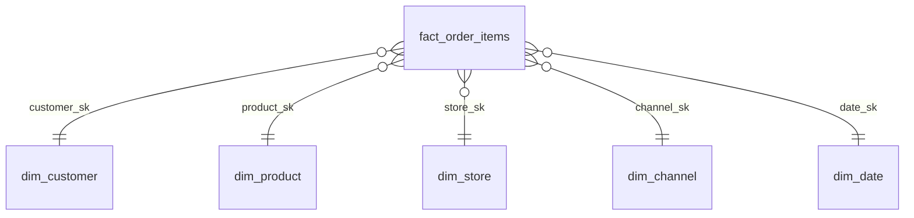

<!--
  Datei:    README.md
  Projekt:  databricks-pipeline (BrewFlow & NorthRiver Data Warehouse)
  Ersteller: Milomir Stevanović
  Änderungshistorie:
    v01 (20.11.2026, Claude): Erstfassung – Projektbeschreibung, Star-Schema, Pipeline, Datenqualität, Szenarien, Power BI, Repo-Struktur
-->

# BrewFlow – Data Warehouse & BI-Pipeline in Databricks

Vom operativen System zum automatisierten, self-healing Data Warehouse mit Power-BI-Dashboard.

**BrewFlow** ist eine fiktive Café-Kette. Für sie habe ich im Finalprojekt des Kurses *Data Modeling & Warehousing* (Masterschool, AI-Powered Data Analyst) den kompletten Weg aufgebaut: von der OLTP-Datenbank über ein Star-Schema mit SCD2-Historisierung bis zu einer täglich laufenden Pipeline in Databricks und einem validierten Power-BI-Dashboard.

📄 **[Executive Report (PDF)](docs/BrewFlow_Executive_Report.pdf)** · 📊 **[Slide Deck (PDF)](docs/BrewFlow_Slide_Deck.pdf)**

---

## Auf einen Blick

| Kennzahl | Wert |
|---|---|
| Datenmodell | Star-Schema: 1 Faktentabelle, 5 Dimensionen, SCD2 für Kunden |
| Pipeline | Lakeflow Job `brewflow_nightly_pipeline`, 3 Tasks, täglich 02:00 Uhr |
| Laufzeit End-to-End | 3 min 18 s |
| Behobene Datenfehler | 4 – jeweils dauerhaft in der Pipeline verankert |
| Getestete Szenarien | 3 (SCD2-Änderung, Neukunde, Late-arriving Order) |
| Validierung | 4 unabhängige Revenue-Visuals liefern denselben Gesamtumsatz: 175,30 € |

**Tools:** SQL · Databricks (Notebooks, Lakeflow Jobs) · PostgreSQL · Power BI · Git/GitHub

---

## Projektverlauf in vier Sprints

1. **OLTP-Datenbank** – Kunden, Produkte, Filialen und Bestellungen der Café-Kette abbilden
2. **Star-Schema** – dimensionales Modell mit SCD2-Historisierung für Kunden
3. **ETL in SQL** – Ladeprozess OLTP → Staging → Warehouse
4. **Automatisierung** – zeitgesteuerte Pipeline in Databricks und Anbindung an Power BI

---

## Architektur: Star-Schema



| Tabelle | Rolle | Zeilen | Besonderheit |
|---|---|---|---|
| `fact_order_items` | Fakten | 34 | Umsatz je Bestellposition, referenziert alle 5 Dimensionen |
| `dim_customer` | Dimension | 12 (10 Kunden) | Slowly Changing Dimension Typ 2 |
| `dim_product` | Dimension | 8 | Kategorien Coffee, Tea, Food, Merchandise |
| `dim_store` | Dimension | 5 | Filialstandorte |
| `dim_channel` | Dimension | 2 | in-store / mobile-app |
| `dim_date` | Dimension | 4.018 | Kalender 2020–2030 |

Jede Dimension hängt direkt an der Faktentabelle – klassisches Star-Schema, kein Snowflaking.

---

## ETL-Pipeline

Lakeflow Job **`brewflow_nightly_pipeline`** mit fester Abhängigkeitskette:

```
03_copy_to_staging  ──►  04_load_dimensions  ──►  05_load_facts
   (1 min 23 s)             (1 min 12 s)             (41 s)
```

| Schritt | Notebook | Aufgabe |
|---|---|---|
| 1 | `03_copy_to_staging` | OLTP-Rohdaten in die Staging-Schicht übernehmen |
| 2 | `04_load_dimensions` | 5 Dimensionen aufbauen bzw. aktualisieren, inkl. SCD2 für Kunden |
| 3 | `05_load_facts` | Fakten per Point-in-Time-Join gegen die historisierte Kundendimension laden |

Manueller End-to-End-Testlauf am 05.09.2026: alle drei Tasks erfolgreich.

---

## Datenqualität: dauerhaft behobene Fehler

Jeder Fehler wurde in der Pipeline selbst behoben – nicht nur einmalig von Hand korrigiert.

| Problem | Ursache | Dauerhafter Fix |
|---|---|---|
| `fact_order_items` blieb leer | `effective_from` in `dim_customer` stand auf dem aktuellen Datum | beim initialen SCD2-Load auf 2020-01-01 zurückdatiert |
| `revenue` = NULL in allen Zeilen | `revenue` fehlte in der INSERT-Spaltenliste von `05_load_facts` | Spalte ergänzt, einmaliges Backfill-Update |
| `product_sk` veraltet/falsch | Restbestände aus einem früheren Lauf | Korrektur-MERGE leitet `product_sk` aus `stg_order_items.product_id` ab |
| Power-BI-Beziehung sprang zurück | Auto-Erkennung wählte `product_id` statt `product_sk` | Beziehung dauerhaft auf `product_sk` fixiert |

---

## Nachweis der SCD2-Logik: drei Szenarien

| Szenario | Notebook | Ergebnis |
|---|---|---|
| A – Loyalty-Upgrade (Bronze → Silver) | `08a scenario a sofia upgrade` | neue aktuelle Zeile in `dim_customer`, alte Zeile wird geschlossen |
| B – Neukunde mit Bestellung | `08b scenario b new customer` | neuer Kunde fließt vollständig durch die Pipeline |
| C – Late-arriving Order | `08c scenario c late order` | Bestellung wird der zum Bestellzeitpunkt gültigen Kundenversion zugeordnet |

---

## Power BI

- Anbindung über den nativen Databricks-Connector in Power BI Desktop
- `is_current`-Filter dauerhaft in Power Query hinterlegt – nur die aktuelle Kundenversion fließt ein
- Vier Revenue-Visuals (Category, Store, Channel, Time) liefern übereinstimmend **175,30 €**

---

## Repository-Struktur

```
databricks-pipeline/
├── README.md
├── docs/                         Executive Report und Slide Deck (PDF)
├── brewflow/                     weitere BrewFlow-Notebooks
├── 03_copy_to_staging*           Pipeline Schritt 1
├── 04_load_dimensions*           Pipeline Schritt 2
├── 05_load_facts*                Pipeline Schritt 3
├── 08a/b/c scenario …            Testszenarien SCD2
└── *_northriver* / Northriver …  Übungsprojekt NorthRiver (gleiche Pipeline-Logik)
```

Notebooks mit `northriver` im Namen gehören zum zweiten Übungsdatensatz **NorthRiver**, der mit derselben Pipeline-Logik nachts in Databricks geladen wird.

---

*Erstellt von Milomir Stevanović im Rahmen der Weiterbildung „AI-Powered Data Analyst“ (Masterschool), 2026.*
